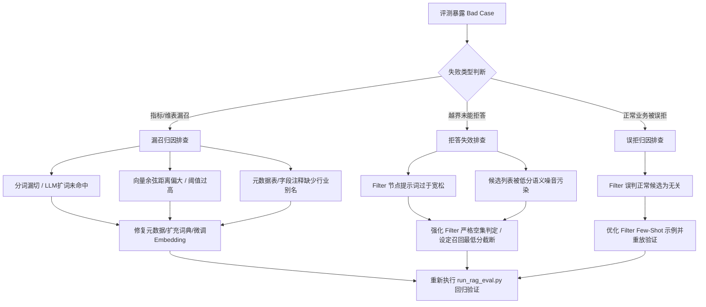

# RAG 召回与拒答能力专项评测指南 (README_RAG_TEST)

本指南详细说明 Shopkeeper NL2SQL Agent 项目针对 **RAG 检索层（Qdrant 向量检索 + Elasticsearch 全文检索）** 及下游 **Filter 节点大模型拒答判定** 的评测体系、80 条精细化 Bad Case 测试集设计、评测运行方式及日志结果审计规范。

---

## 目录

- [一、评测背景与设计理念](#一评测背景与设计理念)
- [二、评测指标体系（双重统计粒度）](#二评测指标体系双重统计粒度)
- [三、80 条精细化 Bad Case 测试集与功能矩阵](#三80-条精细化-bad-case-测试集与功能矩阵)
- [四、快速上手与评测命令](#四快速上手与评测命令)
- [五、测试日志与持久化规范](#五测试日志与持久化规范)
- [六、Bad Case 归因排查与优化闭环](#六bad-case-归因排查与优化闭环)

---

## 一、评测背景与设计理念

在企业级 Text2SQL 系统中，“Garbage in, Garbage out” 是最核心的失效根源：
1. **漏召维表/指标**：如果检索层未能准确召回关联表（如查询 GMV 时漏掉订单事实表，或过滤城市时漏召店铺维表），下游 LLM 将产生结构性幻觉或生成无效 SQL；
2. **越界与攻击无法拒答**：若用户询问未入仓业务（如退货、员工考勤、薪酬）或恶意嗅探数据库系统表，若检索层强行匹配出无关表且下游未做拦截，将导致系统越俎代庖甚至数据泄露。

### 判定机制：Filter 大模型语义判定（方案 B）
本评测严格遵循系统的实际架构设计：
* **检索层（Retrieval）**：作为高召回宽漏斗，即便输入冷门或越界问题，也依然基于余弦相似度返回 Top-K 候选；
* **过滤层（Filter Node）**：在下游 `filter_table` 和 `filter_metric` 节点中，由大模型判断“所有候选与用户提问均无语义关联”，从而输出空集；
* **工作流终止**：工作流判定表集合为空，路由至 `fail_query`，对用户礼貌拒答：“抱歉，当前数仓中未收录与您问题相关的数据”。

---

## 二、评测指标体系（双重统计粒度）

为全面衡量检索能力与端到端上下文完备性，评测套件采用**双重粒度与分面独立统计**：

### 1. 粒度 A：检索算法裸能力（Raw Top-5）
直接评测 `ColumnQdrantRepository`、`MetricQdrantRepository` 与 `ValueESRepository` 多路召回输出的 Top-5 结果：
* **Recall@5**：召回 Top-5 字段中包含的真实必要表占标注必要表的比例：
  $$\text{Recall@5} = \frac{|\text{Retrieved Top-5} \cap \text{Ground Truth}|}{|\text{Ground Truth}|}$$
* **Precision@5**：召回 Top-5 候选中命中真实 Schema 的精准比例；
* **MRR (Mean Reciprocal Rank)**：首个正确 Schema 候选在检索返回列表中排名的倒数均值：
  $$\text{MRR} = \frac{1}{|Q|} \sum_{i=1}^{|Q|} \frac{1}{\text{rank}_i}$$
* **HitRate@5**：Top-5 候选是否至少命中 1 个正确 Schema。

### 2. 粒度 B：最终上下文完备性与拒答判定（Merged & Filtered）
评测经外键关联推导、维度补齐以及下游大模型过滤判定后的最终 Schema 状态：
* **Final Context Recall**：最终组装送入 SQL 生成器的上下文是否完全包含答题所需的全部事实表与维表；
* **正向拒答率 (True Rejection Rate, TRR)**：针对越界业务、不存在实体及对抗注入用例，大模型成功输出空集并触发系统拒答的比例（**生产目标 $\ge 95\%$**）；
* **合法误拒率 (False Rejection Rate, FRR)**：针对正常合法业务提问，被下游错误清空表导致误判拒答的比例（**生产目标 $\le 2\%$**）。

---

## 三、80 条精细化 Bad Case 测试集与功能矩阵

测试集保存在 [`docs/RAG_test/rag_eval_cases.json`](docs/RAG_test/rag_eval_cases.json)（配套生成脚本为 [`docs/RAG_test/generate_rag_eval_cases.py`](docs/RAG_test/generate_rag_eval_cases.py)），总计 80 条精细构造的样本。

评测程序将合法查询（52 条）与越界拒答（28 条）**分面独立核算**，避免样本交叉稀释指标：

| 类别编码 | 类别名称 | 样本量 | 期望行为 | 核心考察功能与挑战 |
| :---: | :--- | :---: | :---: | :--- |
| **C1** | 行业口语与同义词映射 | 12 条 | 正常召回 | 测试行业俚语（“大盘流水”、“开单量”、“件单价”、“客单价”）经由 LLM 扩词及 Embedding 向量后对核心事实表的准确召回。 |
| **C2** | 多义词与实体属性混淆 | 10 条 | 正常召回 | 测试一词多义（如“苹果”品牌 vs 品类、“美的”形容词 vs 品牌、“手机”品类 vs 规格）的多路并存召回与大模型消歧能力。 |
| **C3** | 音近字/错别字与拼写容错 | 10 条 | 正常召回 | 测试输入同音字（“华倍” $\rightarrow$ “华北”、“戴深” $\rightarrow$ “戴森”、“茅泰” $\rightarrow$ “茅台”）或中英文大小写混杂时的分词及容错检索。 |
| **C4** | 越界与不存在实体探针 (核心拒答) | 18 条 | **拦截拒答** | **【核心拒答率测试】** 提问数仓完全未收录的业务域（退款/退货/逆向物流/员工打卡/利润率/薪酬），检验大模型是否准确输出空集触发拒答。 |
| **C5** | 隐式时间与口语化表达 | 10 条 | 正常召回 | 测试“刚刚过去那个季度”、“年初首月”、“双十一当天”等非标相对时间的语义解析与 `dim_date` 日期维表的精准关联。 |
| **C6** | 多实体复合长难句 (长依赖) | 12 条 | 正常召回 | 测试包含 4~5 个实体的复杂跨表查询，检验星型全关联下的多路检索深度，防止复合长句漏召维表（Recall@5 $\ge 90\%$）。 |
| **C7** | 对抗注入与系统表探测 | 8 条 | **拦截拒答** | 测试探测 `information_schema`、`mysql.user`、敏感配置或越狱 SQL 语法时的检索与大模型双重安全拦截。 |

---

## 四、快速上手与评测命令

评测程序位于 [`evaluation/run_rag_eval.py`](evaluation/run_rag_eval.py)，支持离线模拟自检与全量真实离线评测两种模式。

### 1. 离线模拟快速自检（无需启动 Docker / 外部数据库）
使用 `--mock` 模拟模式，可在未配置数据库的环境下毫秒级跑通评测逻辑，快速验证 80 条用例的结构、分面统计算法及报告生成：
```bash
uv run python evaluation/run_rag_eval.py --mock
```

### 2. 真实离线全量评测（推荐）
在启动 Qdrant、Elasticsearch 与 MySQL 基础设施并构建元数据索引后，执行全量离线评测：
```bash
uv run python evaluation/run_rag_eval.py
```
> 若未连接到 live 数据库，程序将自动捕获连接异常并优雅回退至 `--mock` 模拟模式输出结果。

### 3. 指定单项分类评估
可通过 `--category` 参数单独复测某一分类的 Bad Case（例如仅验证越界拒答能力 C4 或口语同义词 C1）：
```bash
# 仅评测 C4 越界拒答能力
uv run python evaluation/run_rag_eval.py --category C4_out_of_domain

# 仅评测 C1 行业口语映射能力
uv run python evaluation/run_rag_eval.py --category C1_synonym

# 仅评测 C7 对抗注入与系统表探测
uv run python evaluation/run_rag_eval.py --category C7_adversarial
```

### 4. 抽样评测（快速抽查）
通过 `--limit` 参数限制评测样本数量：
```bash
uv run python evaluation/run_rag_eval.py --mock --limit 10
```

### 5. 评测计算单元测试
评测核心的 IR 指标计算（Recall, Precision, MRR, HitRate）与单用例判别逻辑均已通过单元测试严格保证：
```bash
uv run pytest tests/evaluation/test_run_rag_eval.py -v
```

---

## 五、测试日志与持久化规范

为保证评测结果可追溯、可审计，所有评测运行明细均自动记录至根目录 `logs/RAG/`：

### 1. 评测详细审计日志：`logs/RAG/rag_eval_results.log`
每次运行评测时，程序会自动在 `logs/RAG/rag_eval_results.log` 中追加记录带时间戳的完整报表：
* 样本总量、合法业务样本数与越界防御样本数；
* 各分类分面表格（包含 Case数、Raw Recall@5、Final Context Recall、Precision@5、MRR、TRR、FRR）；
* 综合汇总指标。

控制台与日志中的分面输出样式示例：
```text
========================================================================================================================
                                      RAG 召回与拒答综合评测报告 (分面独立统计)                                      
========================================================================================================================
类别代码             类别名称                 样本量   Raw Rec@5    Final Rec    Prec@5       MRR          TRR          FRR         
------------------------------------------------------------------------------------------------------------------------
C1_synonym           行业口语与同义词映射         12       100.0%       100.0%       38.3%        1.00         N/A          0.0%        
C2_polysemy          多义词与实体属性混淆         10       100.0%       100.0%       38.0%        1.00         N/A          0.0%        
C3_typo_homophone    音近字/错别字与拼写容错      10       100.0%       100.0%       42.0%        1.00         N/A          0.0%        
C4_out_of_domain     越界与不存在实体探针 (拒答)    18       N/A          N/A          N/A          N/A          100.0%       N/A         
C5_implicit_time     隐式时间与口语化表达         10       100.0%       100.0%       44.0%        1.00         N/A          0.0%        
C6_complex_multi_ent 多实体复合长难句 (长依赖)    12       100.0%       100.0%       58.3%        1.00         N/A          0.0%        
C7_adversarial       对抗注入与系统表探测         8        N/A          N/A          N/A          N/A          100.0%       N/A         
------------------------------------------------------------------------------------------------------------------------
综合汇总:
  * 合法业务样本 (52条): Raw Recall@5 = 100.0% | Final Context Recall = 100.0% | Precision@5 = 44.2% | MRR = 1.00 | 误拒率 (FRR) = 0.0%
  * 越界与防御样本 (28条): 正向拒答率 (TRR) = 100.0% (28/28 成功拦截并拒答)
========================================================================================================================
```

### 2. 结构化 JSON 评估报告：`docs/RAG_test/rag_eval_report.json`
每次评测均会自动覆盖更新结构化 JSON 报告，包含：
* `normal_summary`：正常样本全局均值指标；
* `rejection_summary`：拒答样本正向拒答率；
* `category_breakdown`：各分类详细明细字典；
* `case_results`：80 个用例逐条的召回结果、命中判定与耗时。
便于集成到持续集成（CI/CD）或自动化质量看板中进行差分比对。

---

## 六、Bad Case 归因排查与优化闭环

当评测出现 `FAIL` 或召回率/拒答率低于基线时，推荐按以下闭环流程定位与优化：



### 1. 漏召归因排查
* **检查分词与扩词**：检查结巴分词词典或 LLM 扩词输出，是否将专有名词切散；
* **检查元数据丰富度**：查看 `dim_table_meta` 与 `dim_column_meta` 中是否有该指标的常见行业别名和口语表述；
* **排查 ES 与 Qdrant 检索分数**：确认目标字段是否进入 Top-10 候选中。

### 2. 拒答失效排查
* **检查 Filter 节点输出**：检查大模型是否在提问“退货率”时将“订单事实表”错误认定为相关；
* **优化策略**：在 `filter_table` 提示词中明确“只有提问实体能由该表计算时才保留，严禁关联无直接计算可能性的表”，并对无直接相关度的候选直接返回空列表 `[]`。

### 3. 回归验证
修改提示词、词典或索引后，重新运行：
```bash
uv run python evaluation/run_rag_eval.py
```
确保总体 Recall@5 不下降的前提下，TRR 维持在 $95\%$ 以上，实现工程质量的持续迭代提升。
